# Dual Production Archival & Distribution Engine (Master Specification)

## Goal Description
Deploy and execute two integrated production workflows on the VPS:
1. **Project 1 (Anime Leech, De-duplication Routing & A-Z Master Indexer)**:
   - Finalize the balance 83 anime from the 600-title archival library.
   - Ingest and process two master datasets:
     - `standalone_anime_movies_150.csv` (150 movies under 4GB $\rightarrow$ Target Channel `-1004494800840`).
     - `the_ultimate_uncensored_anime_database_2026.csv` (100 uncensored/ecchi benchmarks $\rightarrow$ Target Channel 1).
   - Implement intelligent de-duplication routing via `copy_message`: if a title already exists in `starfall_state.db` or storage, copy without re-downloading.
   - Deploy Telegram User String Session (`@Hsin_The_Moon_Fox`, `API_ID 32226674`) for files between 2000 MiB and 4000 MiB serialized with `asyncio.Semaphore(1)`.
   - Maintain the `Anime Starfall Index [Tamil]` channel (`-1004480002635`) with full metadata posters and pinned A-Z master directory.
2. **Project 2 (MissAV Uncensored 200GB Megapack Torrent Pipeline)**:
   - Ingest uncensored titles from MissAV at maximum 1080p resolution.
   - Speech-to-text English subtitles via `faster-whisper` (`int8`, `beam_size=1`, VAD pruning) muxed directly into MKV with language tags.
   - Native 10-second preview clips fetched from `https://fourhoi.com/{code}/preview.mp4` (with fallback to local FFmpeg extraction) converted to animated WebP (`scale=480:-1, fps=12`) and hosted on LuminaPix.
   - Slice into ~200 GB batches, generate BBCode descriptions, create private `.torrent` files with `mktorrent -l 24`, and auto-seed in qBittorrent on port 8090.

---

## Architectural Hardening Rules (Opus 4.6 Validated)

> [!IMPORTANT]
> ### 1. Telegram 4GB & Routing Invariants
> - **Upload Semaphore**: Single Pyrogram user string session calls serialized behind `asyncio.Semaphore(1)` to strictly prevent `AUTH_KEY_DUPLICATED` or session invalidation.
> - **Strict 4000 MiB Limit**: File sizes validated against `4000 * 1024 * 1024` bytes (4000 MiB) for User Client and `2000 * 1024 * 1024` bytes for Bot API. Files exceeding limit trigger an alert.
> - **Global Rate-Limiter**: Minimum 1.5s delay between consecutive Telegram API calls across all channels to prevent account-wide FloodWait.
> - **FloodWait Backoff with Jitter**: Catch `FloodWait` and sleep `e.value + random.uniform(1.0, 5.0)`. Circuit breaker triggers after 3 consecutive waits $> 300\text{s}$.
> - **`copy_message` over `forward_messages`**: Uses `app.copy_message()` to suppress "Forwarded from" tags. If source is deleted (`MESSAGE_ID_INVALID`), fall back to local disk re-upload.
> - **Two-Phase Commit**: Record uploaded video message IDs and target index tasks in a `pending_index` SQLite table to ensure no orphan media exists without an index entry.

> [!TIP]
> ### 2. Audio Extraction & faster-whisper CPU Tuning
> - **Disk-Safe Audio**: Extract audio as 16-bit mono 16kHz WAV (`-ac 1 -ar 16000 -sample_fmt s16`) and unlink the WAV file immediately upon transcription completion.
> - **3–5× Throughput Boost**: Use `WhisperModel("small", compute_type="int8", cpu_threads=6)` with `beam_size=1` for rapid CPU transcription.
> - **VAD Silence Pruning**: Configure `vad_parameters=dict(min_silence_duration_ms=1000, speech_pad_ms=200)` to bypass non-dialogue segments.
> - **Watchdog Timeout**: Wrap transcription in `asyncio.wait_for(timeout=duration_sec * 6)` to prevent corrupt segments from hanging the pipeline.
> - **Subtitle Track Metadata**: Mux with `-metadata:s:s:0 language=eng -metadata:s:s:0 title="English"` so players automatically activate English subtitles.
> - **Preview Clip Fallback**: Request `https://fourhoi.com/{code}/preview.mp4` with 2 retries (5s backoff). If unavailable, fall back to `ffmpeg -ss 60 -t 10 -i input.mkv`.

---

## Pipeline Architecture

```mermaid
flowchart TD
    subgraph Project 1: Multi-Channel Harvester & Indexer
        A["Master Catalogs (Movies 150 / Uncensored 100 / Balance 83)"] --> B{"Exists in DB / Storage?"}
        B -- "Yes" --> C["copy_message to Target Channel (0 MB Bandwidth)"]
        B -- "No" --> D{"File Size Threshold"}
        D -- "< 2000 MiB" --> E["Upload via Bot Client"]
        D -- "2000–4000 MiB" --> F["Semaphore(1) Upload via User String Session"]
        E & F & C --> G["Store in Target Channel"]
        G --> H["Record to SQLite pending_index"]
        H --> I["Post Exhaustive Metadata Poster to Index (-1004480002635)"]
        I --> J["Update Pinned A-Z Directory Navigation Message"]
    end

    subgraph Project 2: MissAV 200GB Pack Engine
        M1["MissAV Uncensored Catalog (1080p Stream)"] --> M2["Direct DASH/HLS Stream Ingestion"]
        M2 --> M3["Extract 16-bit Mono 16kHz WAV Audio"]
        M3 --> M4["faster-whisper int8 beam=1 CPU Transcription"]
        M4 --> M5["Mux Video + AAC Audio + English SRT -> MKV"]
        M1 --> P1{"Download Native 10s Clip (fourhoi.com)"}
        P1 -- "Success" --> P2["Convert preview.mp4 to Animated 12fps WebP"]
        P1 -- "Fail" --> P3["Fallback: ffmpeg -ss 60 -t 10 from MKV"]
        P3 --> P2
        P2 --> M6["Upload Cover & Animated WebP to LuminaPix"]
        M5 & M6 --> M7["Slice into ~200 GB Batches"]
        M7 --> M8["mktorrent -l 24 (16MB) + Multi-Tracker BBCode Generation"]
        M8 --> M9["Auto-Seed on qBittorrent Port 8090"]
    end
```



---

## Component Specifications

### 1. Telegram Channel Router (`scripts/telegram_channel_router.py`)
* **Channels**:
  * Index: `Anime Starfall Index [Tamil]` (`-1004480002635`)
  * Movies: `Starfall Anime Movies` (`-1004494800840`)
  * Uncensored: Target Channel 1 (`https://t.me/+j1_cjtviX6g1Yml1`)
* **Session Configuration**:
  ```python
  upload_sem = asyncio.Semaphore(1)
  RATE_LIMIT_DELAY = 1.5  # Seconds between Telegram calls
  ```
* **De-duplication**: Checks `starfall_state.db` table `tamil_audio_library` / `anime_seasons`. If message ID exists, calls `app.copy_message()` to destination chat.

### 2. Exhaustive Ecchi Poster & A-Z Master Indexer (`scripts/generate_az_index.py`)
* **Poster Caption Template**:
  ```text
  🎬 {Anime_Title} ({Release_Year})
  🇯🇵 Romaji: {Alternative_Titles}
  🏢 Studio: {Animation_Studio} | Era: {Era}
  ⭐ Rank: {Rank} | Overall Score: {Overall_Weighted_Score_100}/100
  🔞 Censorship Level: {Censorship_Level}
  🔥 Nudity Score: {Combined_Nudity_Score}/100 (Freq: {Frequency_Of_Nudity_25pct}%, Amount: {Amount_Of_Visible_Nudity_25pct}%)
  💿 Official Release: {Official_Uncensored_Availability}
  📦 BD/DVD Info: {BluRay_DVD_Release_Info}
  📺 Differences: {TV_vs_Home_Video_Differences}

  📖 Description:
  {Content_Description}

  📥 Direct Episode Files: [Click Here to View/Download]({Target_Channel_Msg_Link})
  ```
* **A-Z Master Navigation**: Pinned message updated with `#A` to `#Z` anchors and deep links directly to the poster message ID in `-1004480002635`.

### 3. MissAV 200GB Pack Engine (`scripts/missav_pack_engine.py`)
* **Resolver**: `bot.helper.ext_utils.missav_resolver.MissAVResolver` targeting uncensored categories.
* **Whisper Audio Pipeline**:
  ```python
  # Extract temporary WAV
  cmd = ["ffmpeg", "-y", "-i", video_path, "-vn", "-ac", "1", "-ar", "16000", "-sample_fmt", "s16", wav_path]
  # Transcribe
  model = WhisperModel("small", device="cpu", compute_type="int8", cpu_threads=6)
  segments, _ = model.transcribe(
      wav_path,
      language="ja",
      task="translate",
      vad_filter=True,
      vad_parameters=dict(min_silence_duration_ms=1000, speech_pad_ms=200),
      beam_size=1
  )
  # Unlink WAV immediately
  os.remove(wav_path)
  ```
* **Animated WebP Generation**:
  ```python
  # Try native fourhoi 10s clip first
  clip_path = await _download_preview_video(item, temp_mp4)
  if not clip_path:
      # Local fallback
      subprocess.run(["ffmpeg", "-y", "-ss", "60", "-t", "10", "-i", video_path, "-c", "copy", temp_mp4])
  # Convert to animated WebP
  subprocess.run(["ffmpeg", "-y", "-i", temp_mp4, "-vf", "scale=480:-1:flags=lanczos,fps=12", webp_path])
  ```
* **Packaging**: Auto-chunking at $190 - 210\text{ GB}$, generating BBCode with LuminaPix animated WebP embeds, creating `.torrent` with `mktorrent -l 24`, and injecting into qBittorrent on port 8090.

---

## Verification & Execution Protocol
1. **Telegram Channels Check**: Ensure `@Hsin_The_Moon_Fox` has write permissions in `-1004480002635` and `-1004494800840`.
2. **Dry Run Poster**: Post 1 test movie and 1 test uncensored poster to confirm caption formatting and link navigation.
3. **MissAV Sample Test**: Run 1 video through the complete MissAV pipeline (download $\rightarrow$ whisper int8 $\rightarrow$ mux $\rightarrow$ 10s WebP $\rightarrow$ LuminaPix) and verify output.
4. **Autonomous Execution**: Run both pipelines in background with persistent state ledgers.
